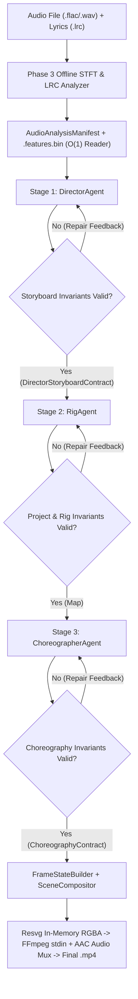

# Phase 4 Architecture: Multi-Agent LLM Orchestration & Self-Healing Pipeline

## 1. Overview & Architectural Objectives

Phase 4 completes the **AI-Agent Animation Studio** by bridging the **Phase 3 Offline Audio Intelligence & LRC Alignment Pipeline** (`AudioAnalysisManifest` + `.features.bin`) and the **Phase 2 2.5D Procedural Cinema & Scene Compositor Engine** (`FrameStateBuilder` + `SceneCompositor` + `RenderPipeline`) through a deterministic, contract-validated **Multi-Agent LLM Orchestration Architecture** (`src/agents/`).

Every LLM-generated output is strictly parsed through `extractJsonFromLlmResponse`, validated against Zod 4 schemas (`DirectorStoryboardContractSchema`, `RigCatalogContractSchema`, `ChoreographyContractSchema`), and verified against cross-contract mathematical invariants (`validateProjectContracts` and `validateChoreography`). Whenever an agent produces a schema or invariant violation, the `StudioAgentOrchestrator` automatically formats the structured `ValidationErrorItem[]` diagnostics into a `[SELF-HEALING REPAIR DIAGNOSTICS]` prompt and re-invokes the offending agent up to `maxRetries` times.



---

## 2. Core Components (`src/agents/`)

### 2.1 LLM Provider Abstraction & Schema Guard (`src/agents/llm-provider.ts` & `src/agents/types.ts`)
- **`LlmProvider` Interface**:
  - `generateStructuredJson<T>(prompt: string, schema: z.ZodType<T>, options?: LlmOptions): Promise<T>`
- **`extractJsonFromLlmResponse(raw: string): unknown`**:
  - Strips UTF-8 BOM (`\uFEFF`) and surrounding whitespace.
  - Extracts JSON payloads from Markdown fenced code blocks (` ```json ... ``` ` or ` ``` ... ``` `) even when surrounded by conversational prose.
  - Falls back to balanced outermost `{ ... }` or `[ ... ]` extraction if no code fence is present.
  - Throws `LlmJsonParseError` with a diagnostic snippet if no valid JSON can be parsed.
- **`OpenAiCompatibleProvider`**:
  - Connects to any OpenAI-compatible Chat Completions endpoint (`OpenAI`, `Gemini`, `Groq`, or local `Ollama` on `http://127.0.0.1:11434/v1`).
  - **Security Hardening**: Rejects non-HTTPS endpoints unless the hostname is `localhost` or `127.0.0.1`; requires an API key from `process.env.LLM_API_KEY` or `process.env.OPENAI_API_KEY` for remote hosts; never hardcodes or logs secrets.
- **`DeterministicMockLlmProvider`**:
  - Provides 100% offline, deterministic, schema-validated JSON synthesis for CI (`npm test`) and local benchmarks (`npm run demo:phase4 -- --mock`).
  - Supports an optional `interceptor` callback for injecting faulty responses on specific attempts to test self-healing recovery.

### 2.2 Stage 1: Principal Director Agent (`src/agents/director-agent.ts`)
- Summarizes `AudioAnalysisManifest` and `AudioFrameFeature` curves into an `AcousticSummary` (BPM, peak onset frames, 7-band energy averages, and aligned lyric intervals).
- Synthesizes a 3-act, 4-shot `DirectorStoryboardContract` (`EXTREME_WIDE` Dolly -> `MEDIUM` Tracking -> `WIDE` Orbit -> `CLOSE_UP` Dolly).
- **Scene & Horizon Continuity Remediation**:
  - Retains the background and midground industrial environment rigs (`rig-skyline`, `rig-factories`, `rig-smoke-chimney`) in `activeRigIds` across **all 4 shots**, including Shot 3 (`CLOSE_UP`), and supplies a continuous 3D ground plane and perspective grid (`getOrchestratedEnvironment`) so the city backdrop never drops to a black void on close-up cuts.

### 2.3 Stage 2: Character & Asset Rig Agent (`src/agents/rig-agent.ts`)
- Generates the complete `Map<string, AssetRigContract>` catalog required by `storyboard.shots`:
  1. **Anatomical Anti-Moonwalk Character Rig (`rig-runner`)**:
     - Declares `facingDirection: "right"` (+X).
     - Configures forward sprint torso lean (`rotationZDegrees: -9` to `-12` deg), right-offset visor (`[5, 9]`) and optical sensors (`[1, 9]`, `[8, 9]`), backward-streaming `coat_tail` and `hair_tie`, and **backward knee flexion** (`leg_l_lower` and `leg_r_lower` with `constraintsDeg: [-140, 0]` and negative angles `-14°` to `-78°` throughout the 24-frame cubic-spline run cycle).
     - Enforces the `RIG_KNEE_BEND_INVERTED` invariant in `validateProjectContracts`: any right-facing rig whose lower-leg joint allows forward knee flexion (`> 5°`) is rejected and automatically repaired.
  2. **Separated Particle Emitter Rigs (`rig-smoke-chimney` vs. `rig-runner-aura`)**:
     - `rig-smoke-chimney`: Stationary industrial smoke plume anchored atop the factory smokestack at `[-150, 220, -380]`.
     - `rig-runner-aura`: Kinetic cybernetic energy trail (`paintRole: 'accent'`, `gravity: [-52, 8]`) attached to the runner's world coordinates.

### 2.4 Stage 3: Choreographer Agent (`src/agents/choreographer-agent.ts`)
- Synthesizes `ChoreographyContract` tracks for every `(shotId, rigId)` pair:
  - Keeps stationary environment rigs (`rig-skyline` at `[0, 200, -900]`, `rig-factories` at `[0, 150, -400]`, and `rig-smoke-chimney` at `[-150, 220, -380]`) at constant world coordinates across all shot cuts.
  - Moves `rig-runner` monotonically in $+X$ (`-110 -> 0 -> 160 -> 295 -> 315`) with `pose.timeScale` scaled proportionally to horizontal speed ($\Delta x / \Delta f$), and tracks `rig-runner-aura` at `[runnerX - 16, 82, -62]`.
  - Enforces the `TRACK_FACING_DIRECTION_MISMATCH` invariant in `validateChoreography`: any track that translates a character opposite to its `facingDirection * sign(scaleX)` is rejected as a moonwalk error and repaired.

### 2.5 Stage 4: Self-Healing Orchestrator (`src/agents/orchestrator.ts`)
- `StudioAgentOrchestrator.orchestrate()` runs each agent stage inside a bounded retry loop (`maxRetries = 3` by default).
- When `ZodError`, `LlmJsonParseError`, `validateProjectContracts`, or `validateChoreography` reports `fatal` or `error` items, the orchestrator appends a `[SELF-HEALING REPAIR DIAGNOSTICS]` block listing every error code, path, and message to the next attempt's prompt.
- Records per-stage telemetry (`AgentAttemptLog`: `agentRole`, `attempt`, `repairedErrorCodes`, `durationMs`).
- If `maxRetries` is exhausted, throws `OrchestrationValidationError` with full diagnostic history.

---

## 3. CLI Usage (`npm run demo:phase4`)

```bash
# Default offline deterministic orchestration using real FLAC + LRC in assets/audio/
npm run demo:phase4

# Explicit CLI flags
npx tsx scripts/demo-phase4-orchestration.ts \
  --audio "assets/audio/trashed-and-scattered.flac" \
  --lrc "assets/audio/trashed-and-scattered.lrc" \
  --start 49 \
  --duration 6 \
  --mock \
  --out phase4_orchestration_demo.mp4
```
