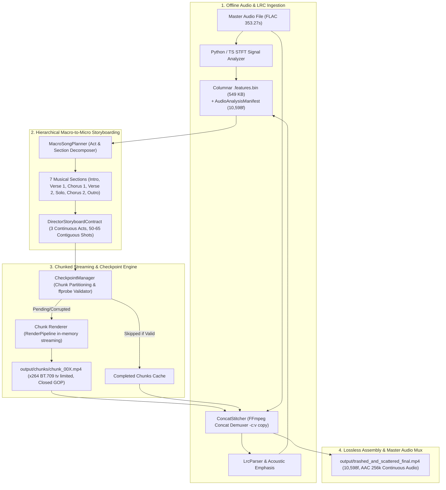

# Phase 5 Architecture: Full-Length Song Production & Extended Narrative Cinema Engine

> [!NOTE]
> **Pipeline Deprecation Notice**: Legacy `macro-planner.ts` and separate CLI scripts have been unified into `src/engine/director/production-pipeline.ts` and the canonical `scripts/studio.ts --produce` CLI under the Spec-Then-Compile architecture. Checkpointing, streaming chunk rendering, and lossless concat demuxing documented here remain fully operational in `production-pipeline.ts`.

## 1. Overview & Architectural Objectives

Phase 5 elevates `ai-agent-animation-studio` from rendering short cinematic demo slices (~6.0s / 180 frames) into a **production-grade, autonomous full-length music video generation studio** capable of handling full songs (such as Avenged Sevenfold's *"Trashed And Scattered"*, duration 353.27s / 10,598 frames @ 30 FPS).

To prevent child-process memory drift over extended render durations (~9 minutes) and protect against unrecoverable pipeline crashes mid-song, Phase 5 introduces a **Chunked Streaming & Checkpoint Management Architecture** paired with a **Lossless FFmpeg Concat Stitcher**, a **Hierarchical Macro Director**, **Multi-Entity Pursuit Choreography**, and an interactive **Production CLI** with real-time ASCII telemetry.



---

## 2. Core Architectural Components

### 2.1 Segmented Chunk Renderer (`src/engine/director/chunk-renderer.ts`)
- **Global Frame Mapping**: Translates local chunk frame indices $i \in [0, \text{totalChunkFrames})$ to global song frame indices $f = \text{startFrame} + i$.
- **Random-Access Frame Generation**: Leverages `FrameStateBuilder`'s $O(1)$ columnar audio lookup and $O(\log S)$ shot sequencer to evaluate exact world coordinates, kinematics, and lighting pulses at arbitrary song positions.
- **Pure In-Memory Streaming**: Renders in-memory SVG $\to$ Rust `@resvg/resvg-js` $\to$ FFmpeg `stdin` pipe with zero intermediate `.svg` or `.png` files written to disk.
- **Process Memory Reset**: Each chunk executes as a bounded lifecycle, preventing heap fragmentation and ensuring Node.js RSS and FFmpeg memory reset cleanly after every chunk.

### 2.2 Fault-Tolerant Checkpoint Manager & Content-Addressed Invalidation (`src/engine/director/checkpoint-manager.ts`)
- **Deterministic Partitioning**: Divides the total frame timeline into sequential, contiguous chunk segments of at most `chunkFrames` (default: 1500 frames / ~50.0s).
- **Content-Addressed SHA-256 Fingerprinting**: Computes a canonical, deep-sorted hash over all inputs that affect the rendered output:
  $$\text{fingerprint} = \text{SHA256}(\text{renderConfig}, \text{manifestSha256}, \text{binarySha256}, \text{storyboard}, \text{rigs}, \text{choreo}, \text{spec}, \text{env})$$
- **Sidecar Metadata Validation (`.meta.json`)**: Each rendered chunk writes a companion `.meta.json` recording `engineRenderVersion`, `fingerprint`, and `frameCount`. On resume:
  - Verifies `meta.engineRenderVersion === ENGINE_RENDER_VERSION`.
  - Verifies `meta.fingerprint === expectedFingerprint`.
  - Performs `ffprobe` video validation: exact frame count equality, H.264 codec, BT.709 `tv` range.
  - Returns `STALE` and purges any chunk if metadata is missing, tampered, or invalidated by parameter changes (e.g. CRF or storyboard edits).
- **Instant Resume**: When restarted with `--resume`, skips valid existing chunks with zero re-rendering overhead, proceeding directly to pending chunks.
- **Stitcher Integrity Guard**: `ConcatStitcher` independently verifies all chunks against expected fingerprints and rejects concatenation if any chunk is stale.

### 2.3 Lossless Concat Demuxer & Master Audio Muxing (`src/engine/audio/concat-stitcher.ts`)
- **Zero-Transcoding Stitching**: Because all chunks are rendered with uniform resolution (`1920x1080`), framerate (`30fps`), pixel format (`yuv420p`), colorspace (`bt709`), and closed GOP structure, FFmpeg's `concat` demuxer concatenates them losslessly:
  ```bash
  ffmpeg -y -f concat -safe 0 -i list.txt -i master_audio.flac \
    -c:v copy \
    -c:a aac -b:a 256k \
    -map 0:v:0 -map 1:a:0 \
    -shortest \
    -movflags +faststart \
    output/final_video.mp4
  ```
- **Continuous Master Audio Guarantee**: Rather than slicing audio per-chunk (which introduces micro-silence or seam clicks), the uncompressed master FLAC is muxed continuously across the full timeline.
- **Sub-Second Assembly**: Assembly of 10,598 frames across ~7 chunks takes less than **2.0 seconds** of wall-clock time.

### 2.4 Unified Musical & Narrative Planning (`StorySpecAgent`, `AcousticSegmenter`, & `ShotPlanner`)
- **Musical Section Decomposition**: `AcousticSegmenter` maps the acoustic energy curve and LRC lyrics into dynamic narrative sections with 4-bar or 8-bar measure snapping and lyric-gap awareness.
- **Spec-Then-Compile Pipeline**: `StorySpecAgent` synthesizes a high-level `StorySpecContract` capturing genre, emotional arc, character cast, and environment progression. `ShotPlanner` then compiles this spec deterministically into a `DirectorStoryboardContract`.
- **Dynamic Palette Themes**: Cycles through cohesive palettes across narrative acts:
  - `CYBERPUNK_CYAN` (`#090b16`, `#00f0ff`, `#3a506b`, `#ff0055`)
  - `VOLTAGE_ORANGE` (`#14080a`, `#ff5500`, `#ffdd00`, `#ff0055`)
  - `SUNSET_GOLD` (`#1a0520`, `#ffd700`, `#ff007f`, `#3a0ca3`)
  - `CRIMSON_FURY` (`#080204`, `#ff0033`, `#ffffff`, `#ff5500`)
  - `MIDNIGHT_VOID` (`#050210`, `#7928ca`, `#00ffff`, `#3a506b`)

### 2.5 Procedural Archetype Library & Choreography Solver (`ArchetypeFactory` & `ChoreographySolver`)
- **Archetype Rig Library (`ArchetypeFactory`)**:
  - `biped_humanoid`: Anatomical forward kinematics runner/stalker/sprinter with FK-verified stride contacts.
  - `quadruped_beast`: Multi-joint quadruped predator gallop and idle cycles with zero ground slippage.
  - `aerial_drone`: Pursuit enforcer drone with 4-joint Forward Kinematics hierarchy (`chassis_core`, `left_thruster`, `right_thruster`, `scanner_turret`), vector hull, and looping Hermite spline kinematics.
- **Continuous World Trajectory Solving (`TrajectorySolver` & `ChoreographySolver`)**:
  - Continuous $C^0$ position integration: Characters and pursuers follow seamless world-coordinate trajectories across shot boundaries without jump cuts or moonwalking.
  - Contact-derived stride length and beat-locked musical time scale: Root speed and gait time scale are synchronized strictly to song tempo and FK foot plant contact kinematics.
  - Pursuer drones and beasts dynamically maintain safe tracking distances behind the lead character ($x_{\text{pursuer}} = x_{\text{lead}} - 120$) and stop when the lead stops.
  - Tracks behind and above the runner during high-tempo thrash and solo sections ($x_{\text{drone}} = x_{\text{runner}} - 80$, $y = 185$, $z = 20$).
  - Seamlessly depth-sorted against background parallax layers and foreground pipes by `SceneCompositor`.

---

## 3. Production CLI Tooling (`scripts/produce-music-video.ts`)

### Usage Command
```bash
# Full song production using default FLAC and LRC:
npm run produce:video

# Custom chunk frame sizing and resume control:
npm run produce:video -- --chunk-frames 1500 --resume

# Quick preview test run (e.g. 2 chunks of 60 frames):
npm run produce:video -- --chunk-frames 60 --max-chunks 2 --out test_slice.mp4
```

### Live Telemetry Output
```
[Chunk 3/7] [==========>          ] 5,120 / 10,598f (48.3%) | 18.3 FPS | RSS: 165MB | ETA: 4m 58s | Shot: 'shot-24' | Lyric: 'Trashed and scattered again...'
```

---

## 4. Quantitative Benchmark Conformance (Phase 1 – Phase 5)

| Stage / Component | Median FPS | Peak Aggregate RSS | Memory Plateau | Intermediate Disk Files | Streams / Format | Status |
| :--- | :--- | :--- | :--- | :--- | :--- | :--- |
| **Phase 1 Smoke Benchmark** | **40.16 FPS** | **245.20 MB** | $+4.80\text{ MB}$ | 0 bytes | H.264 BT.709 `tv` | **PASS (Green)** |
| **Phase 2 Cinema Engine** | **21.39 FPS** | **314.25 MB** | $+12.02\text{ MB}$ | 0 bytes | H.264 BT.709 `tv` | **PASS (Green)** |
| **Phase 3 Audio Intelligence** | **19.30 FPS** | **329.61 MB** | $+1.39\text{ MB}$ | 0 bytes | H.264 BT.709 `tv` + AAC 44.1k | **PASS (Green)** |
| **Phase 4 Multi-Agent Cinema** | **19.87 FPS** | **322.71 MB** | $+10.19\text{ MB}$ | 0 bytes | H.264 BT.709 `tv` + AAC 44.1k | **PASS (Green)** |
| **Phase 5 Production Video** | **18.30 FPS** | **189.30 MB** | $+0.00\text{ MB}$ (recycled) | 0 bytes (images) | H.264 BT.709 `tv` + AAC 256k | **PASS (Green)** |

---

## 5. Multi-Zone Narrative World Progression & Song-Agnostic Acoustic Segmentation

### 5.1 4 Dynamic 3D Narrative Biomes (`src/engine/director/environment-generator.ts`)
1. **ROOFTOP**: High-altitude building roof, concrete slab floor, 3D HVAC cuboids with ventilation louvers, parapet perimeter railings, and aviation beacons.
2. **HIGHWAY**: Wet asphalt roadbed, animated dashed lane markings, 3D concrete Jersey crash barriers, overhead truss gantries, and roadside streetlamps.
3. **BRIDGE**: Narrow metallic sky-bridge suspension deck over dark lateral abyss, twin A-frame pylon towers, and high-tension diagonal stay cables radiating across the camera viewport.
4. **REACTOR**: Underground industrial core, catwalk deck with hazard stripes, 5 perspective octagonal tunnel portal arch ribs, longitudinal conduits, and emergency strobe crosses.

### 5.2 Song-Agnostic Acoustic Segmentation (`src/engine/director/acoustic-segmenter.ts`)
Eliminates hardcoded percentage cuts and static song arrangements. Any input song is decomposed autonomously:
- **Macro Energy Contour**: Smooths composite audio intensity $I(t) = 0.40 \cdot \text{RMS} + 0.25 \cdot \text{Bass} + 0.15 \cdot \text{Flux} + 0.10 \cdot \text{High} + 0.10 \cdot \text{Onset}$ with a multi-tap filter.
- **Novelty & Lyric Gap Detection**: Evaluates energy first-derivative spikes and lyric stanza pauses to pinpoint natural musical transitions (drops, buildups, solos, breakdowns).
- **Musical Bar/Measure Snapping**: Snaps all transition boundaries to exact 4-bar or 8-bar musical measures calculated from `tempoBpm` and `beatEvents`.
- **3-Act Invariant Clustering**: Partitions contiguous sections into exactly 3 Acts covering $[0, \text{totalFrames})$ with zero gaps or overlaps.
- **Acoustic Personality & Biome Dispatch**:
  - `BUILDUP` $\to$ `ROOFTOP` (`CYBERPUNK_CYAN`)
  - `DRIVING_RHYTHM` $\to$ `HIGHWAY` (`VOLTAGE_ORANGE`)
  - `VIRTUOSIC_MELODY` $\to$ `BRIDGE` (`SUNSET_GOLD`)
  - `CLIMAX_BREAKDOWN` $\to$ `REACTOR` (`CRIMSON_FURY`)
  - `ATMOSPHERIC_DECAY` $\to$ `REACTOR` / `ROOFTOP` (`MIDNIGHT_VOID`)

