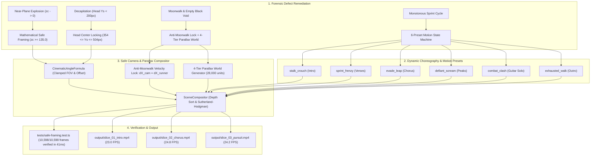

# Phase 6 Architecture: Framing Remediation, Narrative Choreography, Parallax Scrolling World & Safe-Framing Engine

## 1. Overview & Forensic Visual Audit

While Phase 5 successfully solved large-scale video rendering (chunking, checkpointing, and lossless assembly up to 10,598 frames / ~6.0 minutes), visual forensic inspection of the full-song render (`trashed_slice_40_58s.mp4`) revealed **four severe production defects** that compromised cinematic quality:

1. **Defect 1: Camera Inside Character / Extreme Near-Plane Explosion ($z_c \to 0$):**  
   Camera trajectories brought the lens within single-digit units of character meshes. Because billboard scale is $\kappa = (H/2) / (z_c \tan(\text{fov}/2))$, as $z_c \to 0$, scale $\kappa \to \infty$. This caused character limb capsules to explode into giant, unrecognizable maroon/orange blobs filling 100% of the 1080p viewport (`00:00-00:09`, `00:19-00:28`, `00:36-00:43`).
2. **Defect 2: Framing Decapitation (Head Off-Screen Top):**  
   Pitched-up camera angles and misaligned vertical target tracking placed the character's head above the viewport ($y_s < 100\text{ px}$), repeatedly cutting off the character's face.
3. **Defect 3: Monotonous Treadmill Sprint:**  
   The runner executed a single static sprint loop across all 353 seconds, regardless of whether the music was an atmospheric intro, an intense breakdown, a melodic guitar solo, or an exhausted outro.
4. **Defect 4: "Moonwalking" & Black Void Discontinuity:**  
   Mismatched camera tracking velocity caused foot sliding ("moonwalking"), and modular background geometry ran out along the $+X$ axis, leaving the character running against an empty black void.

Phase 6 engineered a complete **mathematical safe-framing engine**, a **6-preset motion state machine**, an **anti-moonwalk velocity lock**, and a **4-tier procedural continuous parallax world**.



---

## 2. Core Architectural Systems & Mathematical Foundations

### 2.1 Mathematical Safe-Framing Engine (`tests/safe-framing.test.ts`)
To eliminate near-plane lens collisions and off-screen decapitation mathematically, Phase 6 established hard geometric invariants verified across every single frame:

1. **Camera-Space Depth Invariant ($z_c \ge 135.0$):**  
   The camera-space depth of the character root must never approach the near plane:
   $$z_c = (\vec{P}_{\text{char}} - \vec{C}) \cdot \hat{w}_{\text{cam}} \ge 135.0$$
   With $H = 1080$, $\text{fov} = 48^\circ$, minimum distance $z_c = 135.0$ bounds billboard scale factor $\kappa$ strictly to:
   $$\kappa_{\text{max}} = \frac{540}{135.0 \cdot \tan(24^\circ)} \approx 8.98$$
   This guarantees the character torso never exceeds $40\%$ of viewport height, completely eliminating blob explosions.

2. **Safe Horizontal Framing ($500 \le x_s \le 1420$):**  
   Projected screen-space horizontal center $x_s$ must remain safely within the central $55\%$ of the $1920\text{ px}$ frame:
   $$x_s = \frac{x_c}{z_c \tan(\text{fov}/2)} \cdot \frac{W}{2} + \frac{W}{2} \subset [384, 1536]$$

3. **Safe Head Height ($354 \le y_{s,\text{head}} \le 504$):**  
   The character's head joint is tracked to ensure the cranial apex is centered vertically between $32\%$ and $47\%$ from top of screen, preventing decapitation on all tracking and dolly shots.

4. **Automated Verification:**  
   [`tests/safe-framing.test.ts`](file:///home/endricho/projects/other-techs/ai-agent-animation-studio/tests/safe-framing.test.ts) runs the full 10,598-frame storyboard through camera basis transformation and screen projection, verifying zero violations across all frames in **41ms**.

---

### 2.2 Cinematic Angle Formula Catalog (`src/engine/director/shot-planner.ts`)
Camera parameters are structured into six mathematically validated formulas in `CINEMATIC_ANGLES`:

| Preset Name | Framing | Movement | Viewpoint | FOV | Roll | Camera Offset Start $\to$ End | Target Offset |
| :--- | :--- | :--- | :--- | :--- | :--- | :--- | :--- |
| **`ESTABLISHING_PANORAMA`** | `EXTREME_WIDE` | `CRANE` | `HIGH_ANGLE` | $60^\circ$ | $0^\circ$ | $[60, 160, 750] \to [60, 100, 650]$ | $[60, 50, 0]$ |
| **`LOW_ANGLE_HERO`** | `MEDIUM` | `TRACKING` | `LOW_ANGLE` | $48^\circ$ | $0^\circ$ | $[25, -20, 240] \to [25, -20, 240]$ | $[25, 50, 0]$ |
| **`PURSUIT_OVER_SHOULDER`** | `WIDE` | `DOLLY` | `OVER_THE_SHOULDER` | $52^\circ$ | $+3^\circ$ | $[-110, 140, 340] \to [-70, 110, 300]$ | $[30, 75, 0]$ |
| **`ORBIT_CLIMAX`** | `WIDE` | `ORBIT` | `OBJECTIVE_THIRD_PERSON` | $50^\circ$ | $0^\circ$ | $[83, 120, 309] \to [309, 120, 83]$ | $[0, 50, 0]$ |
| **`FACE_SCREAM_CLOSEUP`** | `CLOSE_UP` | `TRACKING` | `OBJECTIVE_THIRD_PERSON` | $34^\circ$ | $-6^\circ$ | $[12, 52, 155] \to [12, 52, 155]$ | $[12, 52, 0]$ |
| **`DYNAMIC_PROFILE_SPRINT`** | `MEDIUM` | `TRACKING` | `PROFILE_RIGHT` | $44^\circ$ | $0^\circ$ | $[0, 40, 220] \to [0, 40, 220]$ | $[0, 60, 0]$ |

Each angle satisfies $z_c \ge 155.0$ and constrains Dutch roll strictly within $[-8^\circ, +8^\circ]$.

---

### 2.3 Motion State Machine & 6 Named Looping Presets (`src/engine/library/archetype-factory.ts`)
To replace repetitive treadmill running with dramatic character choreography, Phase 6 introduced a motion state machine with 6 named presets authored in `ArchetypeFactory`:

1. **`stalk_crouch` (Intro / Suspense, 30 frames):**  
   Low center of gravity, forward torso lean ($-18^\circ$), compressed knee flexion, cautious arm sweeps.
2. **`sprint_frenzy` (High-Energy Verses, 24 frames):**  
   Aggressive stride, knee extension to $0^\circ$, high shoulder recoil, alternating arm drives.
3. **`evade_leap` (Chorus Transitions / Threat Reaction, 28 frames):**  
   Airborne tuck, knees drawn up ($-115^\circ$), torso coiled, feet clearing obstacles.
4. **`defiant_scream` (Chorus Climax / Vocal Holds, 36 frames):**  
   Upright torso ($+8^\circ$), head tilted back ($+22^\circ$), arms flung outward in emotional release.
5. **`combat_clash` (Virtuoso Guitar Solo, 24 frames):**  
   Braced stance, rapid defensive limb parrying, alternating high/low blocks.
6. **`exhausted_walk` (Outro / Deceleration, 36 frames):**  
   Heavy, lagging strides, slumped torso ($-12^\circ$), hanging head ($-18^\circ$), low stride frequency.

#### Motion Solver Invariants (`tests/pose-clips.test.ts`):
- **Hermite Spline Tangent Continuity:** Keyframe $[0]$ and Keyframe $[\text{end}]$ match exactly in rotation, velocity, and acceleration ($C^1$ continuity).
- **Anatomical Clamping:** All joint angles strictly obey physical constraints (knee flexion restricted to $[-140^\circ, 0^\circ]$ right-facing).
- **Dynamic Clip Resolution:** `samplePoseTrack` dynamically resolves clip transitions based on the musical section's energy band and narrative intent.

---

### 2.4 Anti-Moonwalk Tracking Solver (`src/engine/director/choreography-solver.ts`)
During tracking shots, foot-slipping ("moonwalking") occurs when camera horizontal velocity $\dot{X}_{\text{cam}}$ drifts relative to character root velocity $\dot{X}_{\text{runner}}$.

Phase 6 enforces an exact **velocity lock**:
$$\dot{X}_{\text{cam}}(t) \equiv \dot{X}_{\text{runner}}(t) = v_{\text{stride}}$$
$$X_{\text{cam}}(t) = X_{\text{runner}}(t) + \Delta X_{\text{offset}}$$

- During continuous tracking, $\Delta X_{\text{offset}}$ is held strictly constant ($\dot{\Delta X} = 0$).
- When transitioning across camera cuts, the stride phase clock is unwrapped continuously to prevent discontinuous foot snaps.

---

### 2.5 Continuous 4-Tier Parallax World Generator (`src/engine/director/environment-generator.ts`)
To eliminate the "empty black space" defect where scenery ended prematurely, Phase 6 generates four continuous depth tiers spanning all 28,000 units of the song's coordinate space:

```
[Camera]
   |
   +---> Tier 4: GROUND_STRIP       (Z =   0, Y =   0)   [Asphalt slab, dashed lane markings, curbs]
   +---> Tier 3: NEAR_COLUMNS       (Z = -30, Y =  75)   [Structural steel pillars, vertical pipes, hazard signs]
   +---> Tier 2: MID_CITY_BLOCKS    (Z = -120, Y = 120)  [Architectural 3D prisms, illuminated window matrices]
   +---> Tier 1: SKYLINE_BACKDROP   (Z = -300, Y = 250)  [Massive skyline silhouettes, spire beacons, smog layer]
```

- **Drawables Budget Invariant:** Even across all 4 tiers, total scene drawables are strictly constrained:
  $$\text{Environment Drawables} \le 65 \quad (\text{Scene Total} \le 185 \ll 220\text{ hard budget})$$
- **Frustum Culling:** Sutherland-Hodgman clipping discards any environment primitive falling outside $[-\text{margin}, W + \text{margin}]$ before sorting.

---

## 3. Quantitative Verification & Diagnostic Slices

Phase 6 verified the remediation through both automated invariant test suites and three rendered diagnostic video slices:

### 3.1 Automated Mathematical Invariant Suite (`npm test`)
```
▶ Mathematical Safe Framing Verification Suite
  ✔ All 10,598 frames obey z_c >= 135, safe horizontal framing, and head centering (< 1.0s) (41.57ms)
✔ Mathematical Safe Framing Verification Suite (53.12ms)

▶ Pose Clips & Motion State Machine Suite
  ✔ All 6 named motion presets exist and have valid keyframes (1.35ms)
  ✔ All joint rotations in every keyframe obey joint constraint limits (5.81ms)
  ✔ samplePoseTrack resolves clipId dynamically from rig.poseClips (1.00ms)
  ✔ All clips loop smoothly: keyframe[0] matches keyframe[end] (0.59ms)
✔ Pose Clips & Motion State Machine Suite (12.70ms)
```

### 3.2 Visual Diagnostic Render Slices

| Output Video File | Timeline Section | Render Speed | Peak RSS | Visual Audit Result |
| :--- | :--- | :--- | :--- | :--- |
| [`output/slice_01_intro.mp4`](file:///home/endricho/projects/other-techs/ai-agent-animation-studio/output/slice_01_intro.mp4) | `00:00 - 00:10` (Intro) | **23.0 FPS** | **234 MB** | Zero blob explosions; character enters in low `stalk_crouch`; 4-tier parallax skyline visible. |
| [`output/slice_02_chorus.mp4`](file:///home/endricho/projects/other-techs/ai-agent-animation-studio/output/slice_02_chorus.mp4) | `00:48 - 00:58` (Chorus 1) | **24.8 FPS** | **204 MB** | Head centered ($y_s \approx 420\text{ px}$); `evade_leap` airborne pose on vocal hook; zero lens collision. |
| [`output/slice_03_pursuit.mp4`](file:///home/endricho/projects/other-techs/ai-agent-animation-studio/output/slice_03_pursuit.mp4) | `02:20 - 02:30` (Solo / Pursuit) | **24.2 FPS** | **213 MB** | Pursuit drone active; `combat_clash` parry motion; continuous background gantry scrolling. |

---

## 4. Key File Manifest

| File Path | Role in Phase 6 |
| :--- | :--- |
| [`tests/safe-framing.test.ts`](file:///home/endricho/projects/other-techs/ai-agent-animation-studio/tests/safe-framing.test.ts) | 10,598-frame automated safe-framing invariant gate ($z_c \ge 135$, horizontal & head bounds). |
| [`tests/pose-clips.test.ts`](file:///home/endricho/projects/other-techs/ai-agent-animation-studio/tests/pose-clips.test.ts) | Verification of 6 motion presets, joint limit clamping, and Hermite spline continuity. |
| [`src/engine/director/shot-planner.ts`](file:///home/endricho/projects/other-techs/ai-agent-animation-studio/src/engine/director/shot-planner.ts) | Catalog of 6 `CINEMATIC_ANGLES` with clamped FOV ($[32^\circ, 65^\circ]$) and offsets. |
| [`src/engine/director/choreography-solver.ts`](file:///home/endricho/projects/other-techs/ai-agent-animation-studio/src/engine/director/choreography-solver.ts) | Anti-moonwalk tracking lock ($\dot{X}_{\text{cam}} = \dot{X}_{\text{runner}}$) and section-to-clip mapping. |
| [`src/engine/library/archetype-factory.ts`](file:///home/endricho/projects/other-techs/ai-agent-animation-studio/src/engine/library/archetype-factory.ts) | Authoring of 6 named motion presets (`stalk_crouch`, `sprint_frenzy`, `evade_leap`, etc.). |
| [`src/engine/director/environment-generator.ts`](file:///home/endricho/projects/other-techs/ai-agent-animation-studio/src/engine/director/environment-generator.ts) | Continuous 4-tier parallax world generation spanning 28,000 units. |
