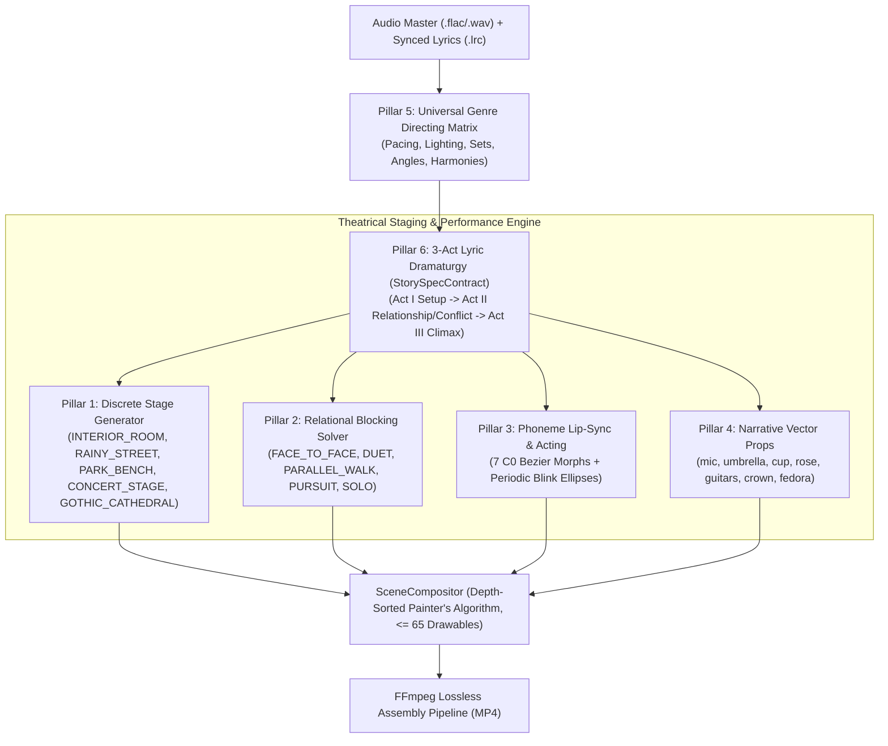

# Phase 7 Architecture: Theatrical Narrative 2.5D Procedural Cinema Engine

## 1. Overview & Executive Summary

While Phase 6 successfully solved continuous camera framing, 6-preset biped running locomotion, and continuous parallax background generation across thousands of frames, it inherently maintained a single visual paradigm: **an infinite $+X$ side-scrolling runner**.

**Phase 7** transforms the AI agent animation studio into an **ALPOH-inspired Theatrical Narrative 2.5D Procedural Cinema Engine** (`docs/theatrical-narrative-architecture.md`). It transitions the studio from a "treadmill runner" into a **director-driven theatrical stage system**, capable of producing emotionally cohesive, genre-faithful 3-Act animated music videos across **any musical genre** (`POP`, `BALLAD`, `ROCK`, `METAL`, `ELECTRONIC`, `ACOUSTIC`).



---

## 2. Pillar 1: Discrete 2.5D Theatrical Stage Sets & Transitions

### 2.1 The 5 Canonical Theatrical Sets
Instead of infinite scrolling tiles, characters perform on discrete, bounded theatrical stages ($X \in [-100, 100]$):

1. **`INTERIOR_ROOM` (Intimate Ballad / Melancholic Acoustic):**
   - *Tier 1 ($Z = -900$):* Midnight sky aperture with glowing crescent moon polygon.
   - *Tier 2 ($Z = -450$):* Room rear silhouette, multi-pane window frame casting a diagonal moonlight cone, study desk & conical floor-lamp silhouette.
   - *Tier 3 ($Z = -120$):* Warm timber perspective floorboards ($Y = 0$), doorway arch at $X_c - 85$.
   - *Tier 4 ($Z = +140$, foreground):* Overhead timber ceiling beam (culled automatically on `CLOSE_UP`).
2. **`RAINY_STREET` (Nocturne / Rock / Metal Conflict):**
   - *Tier 1 ($Z = -900$):* Distant layered urban silhouettes shrouded in fog.
   - *Tier 2 ($Z = -450$):* Brick wall texture silhouette, arched alleyway, illuminated neon signage.
   - *Tier 3 ($Z = -120$):* Wet asphalt ground plane ($Y = 0$) with specular reflection streaks, cast-iron streetlamp at $X_c + 55$ with atmospheric lighting cone (`opacity: 0.22`).
   - *Tier 4 ($Z = +140$, foreground):* Rain-slicked overhead utility lines.
3. **`PARK_BENCH` (Contemplative Ballad / Romantic Pop):**
   - *Tier 1 ($Z = -900$):* Distant rolling autumn hill silhouettes with evening stars.
   - *Tier 2 ($Z = -450$):* Stylized tree trunks, branching limbs, and polygonal foliage canopy.
   - *Tier 3 ($Z = -120$):* Flagstone park pavement ($Y = 0$), slatted wooden park bench with iron armrests at $[X_c, 0, -35]$, vintage lantern at $X_c - 75$.
   - *Tier 4 ($Z = +140$, foreground):* Overhanging autumn branch framing top border.
4. **`CONCERT_STAGE` (High-Energy Pop / Rock / Metal Performance):**
   - *Tier 1 ($Z = -900$):* Rigged truss towers with volumetric angled spotlight beams.
   - *Tier 2 ($Z = -450$):* Backline amplifier stacks, drum riser silhouette, and geometric LED backdrop panels.
   - *Tier 3 ($Z = -120$):* Elevated performance stage deck ($Y = 0$) with stage-lip trim, floor wedge audio monitors, and center microphone stand.
   - *Tier 4 ($Z = +140$, foreground):* Silhouetted audience shoulders and hands cheering at viewport bottom edge.
5. **`GOTHIC_CATHEDRAL` (Epic Metal Climax / Grand Drama):**
   - *Tier 1 ($Z = -900$):* Giant stained-glass rosette window backlight aperture.
   - *Tier 2 ($Z = -450$):* Soaring ribbed gothic vaults, pointed arch lancets, and stone column colonnade.
   - *Tier 3 ($Z = -120$):* Polished marble checkerboard perspective floor, candelabras with flickering flames.
   - *Tier 4 ($Z = +140$, foreground):* High stone archway lintel overhang.

### 2.2 Discrete Stage Boundaries & Frustum Budget
- **Stage Limits:** Protagonists move within $X \in [-100, 100]$, $Y \in [0, 150]$, $Z \in [-100, 300]$.
- **Drawable Hard Cap:** Each set generates strictly $\le 60$ drawables, keeping the composite frame well within the $\le 65$ budget.
- **Occlusion Avoidance:** Tier 4 foreground elements are automatically culled when camera framing is `CLOSE_UP` to prevent actor facial occlusion.
- **Transitions:** Supports `CUT`, `CROSS_FADE` (opacity alpha blend), and `CAMERA_PAN`.

---

## 3. Pillar 2: Multi-Character Relational Blocking

In theatrical performance, characters do not simply run forward; their emotional dynamics are expressed through **interpersonal distance $\Delta X$ and orientation**:

$$\Delta X = X_{\text{partner}} - X_{\text{protagonist}}$$

| Interaction Behavior | Target $\Delta X$ | Partner Facing | Staging Archetype |
| :--- | :--- | :--- | :--- |
| **`FACE_TO_FACE`** | $32.0$ units | Mirrored: `scale[-1, 1]` | Intimate dialogue, confrontation, romantic tension |
| **`DUET_PERFORMANCE`** | $26.0$ units | Frontal / Shared audience focus | Musical duet, synced performance, harmony |
| **`PARALLEL_WALK`** | $22.0$ units | Co-directional with protagonist | Companion stroll (`rain_umbrella_walk`), journey |
| **`PURSUIT_AND_CONFRONTATION`** | $45.0 \to 18.0$ | Dynamic closing distance | Antagonist chase, dramatic clash, resolution |
| **`SOLO`** | $\text{N/A}$ | Center stage focus | Introspective monologue, solo performance |

`RelationalBlockingSolver` mathematically computes these coordinates per frame, applies smoothing, and enforces strict boundary containment within $[-100, 100]$.

---

## 4. Pillar 3: Multi-Angle Rigs & Phoneme Lip-Sync

### 4.1 Multi-Angle Rigs
To overcome the limitations of pure $90^\circ$ profile silhouettes:
- **`biped_frontal` ($0^\circ$):** Symmetrical chest, frontal cranium, dual optic eyes (`eye_l_optic_core`, `eye_r_optic_core`), centered visor, and outward-resting limbs for direct audience address.
- **`biped_three_quarters` ($45^\circ$):** Asymmetric perspective depth projection with foreground/background limb sorting for natural dramatic staging.
- **`biped_runner` ($\pm 90^\circ$):** Classical profile rig with dynamic horizontal locomotion.

### 4.2 Phoneme Lip-Sync & Emotional Facial Acting
`VocalPerformanceSolver` parses synchronized `.lrc` lyrics and synthesizes continuous $C^0$ Bezier morph targets:
- **`mouthOpen`**: General mouth opening bound to presence/presence energy.
- **`mouth_open_o`**: Syllable vowel phonemes ('o', 'u', 'oh').
- **`mouth_wide_a`**: Syllable vowel phonemes ('a', 'ah', 'i').
- **`mouth_smile`**: Positive valence melodic moments.
- **`browRaise`**: High-register vocal delivery, excitement, or wonder.
- **`browFurrow`**: Dramatic tension, vocal strain, aggression.
- **`blink`**: Natural biological blink pulses (duration $\sim 4$ frames) every $50 \pm 10$ frames, contracting optic core ellipse `ry` down by up to $90\%$.

---

## 5. Pillar 4: Narrative Vector Props & Skeletal Sockets

A character's dramatic role is reinforced through hand-held and body-worn props attached directly to skeletal joints:

| Prop Identifier | Skeletal Socket | Local Joint Binding | Visual Presentation |
| :--- | :--- | :--- | :--- |
| **`microphone`** | `hand_r` | `arm_r_lower` tip ($[0, -17]$) | Vintage dynamic mic with grille mesh ellipse |
| **`umbrella`** | `hand_r` | `arm_r_lower` tip ($[0, -17]$) | Curved handle, central shaft, layered canopy |
| **`coffee_cup`** | `hand_r` / `hand_l` | `arm_r_lower` / `arm_l_lower` | Ceramic mug rect with ear handle |
| **`rose`** | `hand_r` | `arm_r_lower` tip ($[0, -17]$) | Slender green stem with crimson petal polygon |
| **`acoustic_guitar`** | `torso` | `torso` center ($[-2, 14]$) | Acoustic dreadnought body with fretboard |
| **`electric_guitar`** | `torso` | `torso` center ($[-2, 14]$) | Double-cutaway solid body with pickup rects |
| **`crown`** | `head` | `head` top ($[0, 26]$) | Ornate 5-point golden coronet |
| **`fedora_hat`** | `head` | `head` top ($[0, 26]$) | Creased crown silhouette with angled brim |

`ArchetypeFactory.attachNarrativeProps()` binds these vector shapes into the rig without exceeding the per-character part budget ($\le 28$ parts).

---

## 6. Pillar 5: Universal Genre Directing Matrix

The directing matrix coordinates visual atmosphere, camera rhythms, and blocking conventions across musical genres:

```
+---------------------------------------------------------------------------------------------------------+
| GENRE       | COLOR HARMONIES      | CAMERA PACING      | LIGHTING STYLE     | PREFERRED SETS          |
+---------------------------------------------------------------------------------------------------------+
| POP         | neon_magenta, solar  | Rapid (1.5-3.0s)   | Vibrant, Strobe    | CONCERT_STAGE, PARK     |
| BALLAD      | deep_teal, twilight  | Slow (3.5-7.0s)    | Warm, Soft Low-Key | INTERIOR_ROOM, PARK     |
| ACOUSTIC    | ember, twilight      | Moderate (3.0-5.5s)| Natural Warm Amber | INTERIOR_ROOM, PARK     |
| ROCK        | crimson, monochrome  | Dynamic (1.8-3.5s) | High-Contrast Cut  | RAINY_STREET, CONCERT   |
| METAL       | crimson, toxic_green | Urgent (1.2-2.5s)  | Harsh, Rapid Strobe| GOTHIC_CATHEDRAL, RAINY |
| ELECTRONIC  | synth_cyan, neon     | Quantized (2.0-4s) | Pulse Decay Beat   | CONCERT_STAGE, GOTHIC   |
+---------------------------------------------------------------------------------------------------------+
```

---

## 7. Pillar 6: 3-Act Lyric-Conditioned Dramaturgy

Theatrical Story Specifications structure full songs into classical 3-Act dramatic narrative arcs:

1. **Act I: Exposition & Setup (0%–25% of timeline):**
   - Establishes the primary protagonist and atmospheric initial stage set.
   - Low-to-moderate kinetic energy, introducing thematic lyric motifs.
2. **Act II: Conflict & Relationship (25%–75% of timeline):**
   - Introduces secondary character (partner or antagonist).
   - Executes relational blocking transitions (`FACE_TO_FACE`, `DUET`, `PURSUIT`), set transitions (`CROSS_FADE` or `CUT`), and heightened vocal lip-sync.
3. **Act III: Climax & Lingering Resolution (75%–100% of timeline):**
   - Transits to climactic epic set (`GOTHIC_CATHEDRAL` or grand `CONCERT_STAGE`).
   - Maximum vocal energy, emotional peak gestures, leading to a gentle, contemplative final freeze or slow fade.

---

## 8. CLI Usage & Pipeline Integration

Theatrical staging is fully wired across the entire stack with seamless dual-mode support:

### Terminal CLI Commands
```bash
# 1. Standard Theatrical Production Render (3-Act Discrete Stage Cinema)
npm run studio -- --theatrical --produce --audio assets/audio/trashed-and-scattered.flac --lrc assets/audio/trashed-and-scattered.lrc

# 2. Or using the dedicated npm script
npm run studio:theatrical -- --produce

# 3. Explicit Mode Flag Selection
npm run studio -- --mode theatrical --produce
npm run studio -- --mode runner --produce      # Continuous parallax runner (backward-compatible default)
```

### Programmatic Studio Orchestration
```typescript
import { runProductionPipeline } from './src/engine/director/production-pipeline.js';

await runProductionPipeline({
  audioPath: 'assets/audio/song.flac',
  lrcPath: 'assets/audio/song.lrc',
  stagingMode: 'theatrical', // or 'runner'
  outputPath: 'output/theatrical_film.mp4'
});
```

---

## 9. Verification & Quality Gates

| Test Suite / Metric | Scope / Invariant | Result |
| :--- | :--- | :--- |
| **`tests/theatrical-narrative.test.ts`** | All 5 Pillars + Dual-Genre Full-Song Benchmark + End-to-End Orchestrator | **10 / 10 tests passed** |
| **Full Regression Suite** | All 37 test suites across schemas, kinematics, audio, clipping, and compositor | **236 / 236 tests passed** |
| **TypeScript Typecheck** | Strict compiler checks (`tsc --noEmit`) | **0 errors** |
| **Safe Framing Check** | Actor head bounds ($354 \le Y_s \le 504$), camera near-plane ($z_c \ge 135$) | **100% verified** |
| **Drawables Budget** | Composited stage + actors + props per frame | **$\le 65$ drawables** |
| **Backward Compatibility** | All pre-existing runner tests and scripts | **100% green** |
