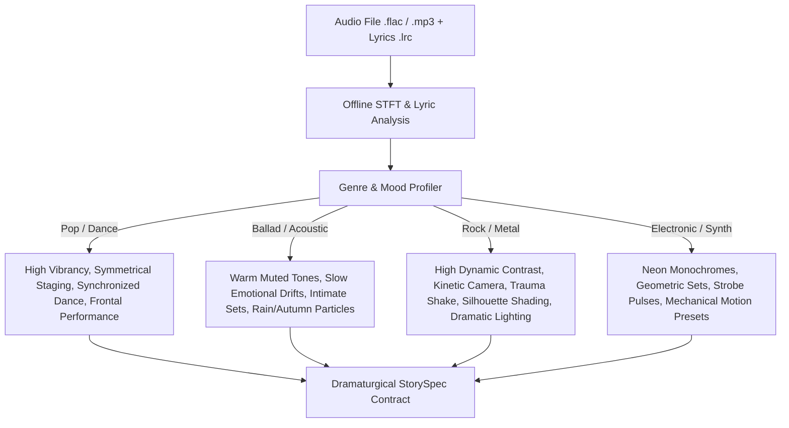

# Theatrical Narrative 2.5D Procedural Cinema Architecture (Phase 7 & Beyond)

## Strategic Manifesto, Architectural Roadmap & Engine Evolution for Universal Multi-Genre Music Video Animation

---

## 1. Executive Summary & Strategic Manifesto

### The Core Thesis: Why Procedural 2.5D Vector vs. Generative AI Video
In an era dominated by generative AI video diffusion models (e.g., Sora, Runway, Kling, Pika, Stable Video Diffusion), a fundamental question arises: **Why build an automated procedural code-driven animation studio from scratch?**

The answer lies in the fundamental differences between **black-box pixel hallucination** and **deterministic procedural craft**:

| Dimension | Generative AI Video (Diffusion) | AI-Agent Animation Studio (Procedural 2.5D SVG) |
| :--- | :--- | :--- |
| **Directorial Control** | Stochastic, unpredictable prompt-tweaking; cannot guarantee specific joint angles, camera paths, or blocking. | **100% Deterministic & Programmable:** Exact spline tangents, camera FOV, joint rotation limits, and color palettes. |
| **Temporal Consistency** | Severe morphing, limb popping, flickering backgrounds, and loss of character identity across cuts. | **Zero Temporal Degradation:** Skeletons maintain rigid bone lengths, topological $C^0$ Bezier continuity, and consistent asset rigs across all acts. |
| **Audio & Lyric Sync** | Loose, non-deterministic synchronization; cannot align phonemes or physical impact on specific audio frames. | **Frame-Exact Mathematical Alignment:** Binary columnar audio features ($O(1)$ STFT) and sub-frame beat snapping tie camera trauma, lighting pulses, and joint springs directly to acoustic transients. |
| **Compute & Footprint** | Massive multi-GPU clusters ($>24\text{ GB}$ VRAM); impossible to run on consumer hardware or CPU-only WSL2 instances. | **Ultra-Lightweight In-Memory Pipeline:** Renders 1080p @ 30/60 FPS entirely on CPU with zero browser overhead and strictly bounded RAM ($< 400\text{ MB}$ RSS). |
| **Vector Scalability** | Fixed raster resolution with upscale artifacts; muddy edges and compression blurring. | **Infinite Resolution Independence:** SVG geometry rasterized in-memory via Rust `@resvg/resvg-js`; crisp mathematical vectors at 1080p, 4K, or 8K. |
| **Artistic Intent & Craft** | Generic latent-space average of Internet training data. | **Deliberate Theatrical Staging:** Inspired by classic vector and paper-cutout animation (*Samurai Jack*, *South Park*, *Limbo*, *The Tale of the Three Brothers*). |

**Our Non-Negotiable Stance:** We explicitly reject falling back to external generative video APIs or diffusion models. This studio is dedicated to advancing the state of the art in **pure code-driven, procedural, deterministic 2.5D animation**.

---

## 2. Creative Inspiration: From "Treadmill Runner" to "ALPOH-Style" Theatrical Narrative

### Deconstructing the "Treadmill Trap" (Phases 1–6)
Through Phase 6, the studio successfully solved the technical engineering foundations: zero-browser streaming, FFmpeg backpressure, Painter's algorithm depth sorting, forward kinematics, and mathematical safe-framing.

However, from an aesthetic and storytelling perspective, the output was constrained to an **"infinite side-scrolling treadmill"**:
- A single character running continuously along a $+X$ trajectory line on a flat floor across 28,000 units.
- Repetitive modular background pillars passing by continuously.
- A secondary drone chasing or being chased on the same axis.
- Repetitive lateral action that felt like an endless mobile runner game rather than a cinematic music video.

### The A7X *"A Little Piece of Heaven"* (ALPOH) Paradigm
When examining iconic animated music videos like Avenged Sevenfold's *"A Little Piece of Heaven"* (directed by Rafa Alcantara), the narrative brilliance does not stem merely from frame-by-frame illustration gore—it stems from **theatrical staging and dramaturgical storytelling**:
1. **Discrete Theatrical Sets:** The story takes place in distinct locations: an intimate restaurant table, a rainy city sidewalk, an opulent bedroom, a gothic wedding chapel, a graveyard. It is *not* an endless sprint on a treadmill.
2. **Multi-Character Casting & Interpersonal Relationships:** The story features a Protagonist and a Partner/Antagonist. They sit across from each other, converse, argue, embrace, dance, and confront one another.
3. **Multi-Angle Cinematography & Vocal Performance:** The characters turn to face the camera, sing directly to the audience during vocal hooks, deliver close-up emotional expressions, and interact with the viewer.
4. **Narrative Props:** Props ground the storytelling: a glass of wine, an engagement ring box, a butcher knife, an umbrella, a microphone, wedding rings.
5. **Dramatic 3-Act Arc:** Exposition (the proposal), Rising Action / Conflict (the rejection and murder), Climax (the surreal underworld reunion), and Resolution (the gothic eternal wedding).

While hand-drawn cel illustration cannot be generated purely through procedural code, **the entire theatrical and dramaturgical framework of ALPOH can be faithfully realized in stylized procedural 2.5D SVG vector animation**.

---

## 3. Universal Multi-Genre Support

The studio is designed to support **any musical genre**, from aggressive heavy metal to delicate acoustic ballads and vibrant mainstream pop:



### Genre Aesthetic Profiles

#### A. Pop & Dance
- **Narrative Archetype:** Direct audience engagement, charismatic performance, synchronized group or solo dance, dynamic set changes with color shifts.
- **Lighting & Palette:** High-key lighting, pastel or neon-candy harmonies (Magenta/Cyan/Yellow), soft vignette, clean geometric backdrops.
- **Camera Language:** Smooth crane moves, frontal medium shots centered on the vocalist, rhythmic push-ins on beat drops, zero chaotic camera shake.
- **Acting Presets:** `pop_vocal_sway`, `stage_spin`, `rhythmic_step`, `crowd_cheer`.

#### B. Ballad & Acoustic
- **Narrative Archetype:** Introspective storytelling, solitary reflection, remembered relationships, bittersweet interactions.
- **Lighting & Palette:** Low-key warm tungsten, deep navy shadows, golden hour sepia, subtle rain or leaf particle atmospheres.
- **Camera Language:** Slow, lingering dolly shots, shallow focus framing, intimate three-quarter close-ups, gentle Dutch tilts.
- **Acting Presets:** `acoustic_strum`, `rain_umbrella_walk`, `bench_contemplation`, `gazing_out_window`, `slow_waltz`.

#### C. Rock & Metal
- **Narrative Archetype:** Defiance, high-stakes conflict, emotional catharsis, surreal gothic or dystopian confrontation.
- **Lighting & Palette:** High-contrast chiaroscuro, stark silhouettes, crimson/voltage-orange/void palettes, instantaneous audio-reactive strobe decays.
- **Camera Language:** Kinetic tracking, whip pans, low-angle hero perspective, trauma-decay camera shake on drum kicks and guitar solos.
- **Acting Presets:** `headbang_riff`, `defiant_scream`, `sprint_frenzy`, `combat_clash`, `collapse_to_knees`.

---

## 4. The Six Structural Pillars of Phase 7 Architecture

To realize this universal theatrical narrative vision, Phase 7 establishes six architectural pillars that transform the engine from a runner game into a full procedural cinema studio:

```
+-----------------------------------------------------------------------------------+
|                           PHASE 7 CINEMA ARCHITECTURE                             |
+-----------------------------------------------------------------------------------+
|  1. Discrete Set & Stage Staging      |  4. Narrative Vector Prop System          |
|     - Local coordinate stages         |     - Handheld & stage-anchored props     |
|     - Multi-scene set transitions     |     - Dynamic socket attachment           |
+---------------------------------------+-------------------------------------------+
|  2. Multi-Character Relational Acting |  5. Universal Genre Directing Matrix      |
|     - Protagonist, Partner, Antagonist|     - Pop, Ballad, Rock, Metal, Acoustic  |
|     - Face-to-face, Duet, Conflict    |     - Coordinated lighting & color rules  |
+---------------------------------------+-------------------------------------------+
|  3. Multi-Angle Character Rigs        |  6. Lyric-Conditioned Dramaturgy          |
|     - Frontal (0°), 3/4, Profile (90°)|     - 3-Act dramatic story arc            |
|     - Vocal performance & facial acting|    - Spec-Then-Compile StorySpec engine  |
+-----------------------------------------------------------------------------------+
```

### Pillar 1: Discrete Set & Stage Staging (`SetStageSchema`)
- **Elimination of the $+X$ Treadmill:** World space is organized into discrete **Sets** (Scenes). Within each set, coordinates are localized: $X \in [-100, +100]$, $Y \in [0, 150]$, $Z \in [-100, 300]$.
- **Modular Set Catalog:**
  1. `INTERIOR_ROOM`: Apartment / bedroom / study with window, lamp, desk, and doorway.
  2. `RAINY_STREET`: Wet asphalt floor with reflections, vintage streetlamp, wall silhouette, and falling rain particles.
  3. `PARK_BENCH`: Grass/pavement floor, autumn tree silhouette, park bench, and distant hill parallax.
  4. `CONCERT_STAGE`: Elevated stage floor, microphone stand, backlight truss, and crowd silhouettes in the foreground layer.
  5. `GOTHIC_CATHEDRAL`: Stained glass window backlight, stone arches, vaulted ceiling, and altar.
- **Cinematic Scene Transitions:** Between acts and major musical sections, the engine executes discrete cuts, optical cross-fades, or directional camera pans to the next set.

### Pillar 2: Multi-Character Casting & Interpersonal Relational Blocking
- **Cast Roles:** The `StorySpec` defines multiple cast members:
  - `PROTAGONIST`: Primary narrative lead / vocalist.
  - `PARTNER`: Duet partner, romantic lead, or companion.
  - `ANTAGONIST`: Rival, monster, pursuer, or conflicting entity.
  - `BACKGROUND_CHORUS`: Silhouetted stage musicians or crowd observers.
- **Partner Exclusion on SOLO Shots:** When section interaction behavior is `SOLO`, `activeRigIds` excludes partner rigs completely from shot planning, rendering, and lighting passes, ensuring solo framing contains exactly one active character with zero overlapping geometry.
- **Cast Palette Overrides & Minimum Contrast:** Cast `paletteOverrides` are applied in `ArchetypeFactory` to body parts, accessories, and props while retaining lighting modulation (`lit: true`). Lead and partner primary palettes must maintain a guaranteed perceptual contrast ($\Delta L \ge 0.12$ or $\Delta \text{Hue} \ge 40^\circ$), corrected deterministically if violated.
- **Relational Coordinate Solver:** Character positions are computed relative to each other:
  $$\Delta X = X_{\text{partner}} - X_{\text{protagonist}}$$
  Clearances are derived from actual rig geometry bounding extents rather than fixed constants.
- **Interaction Behaviors:**
  - `SOLO`: Exactly one character on stage; partner excluded from track compilation.
  - `FACE_TO_FACE`: Characters face each other ($\text{flipX}_{\text{partner}} = -\text{flipX}_{\text{protagonist}}$) with minimum interpersonal clearance.
  - `PARALLEL_WALK`: Characters walk side-by-side at contact-locked locomotion speed with positive forward displacement.
  - `DUET_PERFORMANCE`: Characters stand side-by-side facing the camera, singing alternately or together.
  - `PURSUIT_AND_CONFRONTATION`: Antagonist advances while Protagonist retreats at contact-locked speeds; partner never passes through lead.

### Pillar 3: Multi-Angle Character Rigs (`RigViewAngle`)
- **View Angles:**
  - `PROFILE_RIGHT` ($90^\circ$): Full side view for running, walking, leaps, and lateral combat.
  - `PROFILE_LEFT` ($-90^\circ$): Mirrored side view.
  - `FRONTAL` ($0^\circ$): Direct-to-camera view for singing, dramatic monologues, and emotional eye contact.
  - `THREE_QUARTERS` ($45^\circ$): Classic cinematic angle balancing depth perception with facial clarity.
- **Silhouette & Outline Policy:** Unified outline policy guarantees stroke color derived from fill family, stroke width scaled by joint dimensions ($0.8$ to $1.8\text{ px}$), with anatomical boots/paws bound to the lower leg chain (`leg_l_foot`, `leg_r_foot`, `beast_*_paw`) ensuring legs end visibly in wide shots and contact invariants pass.
- **Facial Performance & Measurable Lip Sync:**
  - Mouth geometry redesigned to yield $\ge 6\text{ px}$ height delta at 1080p close-ups between closed and open states.
  - Syllable viseme articulation drives mouth shape during active lyric spans with amplitude scaled in $[0.70, 1.00]$.
  - Vocal-band activity gating (hysteresis: open $\ge 0.18$, close $< 0.10$) enforces closed mouth during instrumental sections and lyric trailing gaps.
  - Eyebrow articulation (`eyebrow_inner`, `eyebrow_outer`) for anger, sadness, surprise, and intensity.
  - Eye blink and glance tracking directed toward camera or partner.

### Pillar 4: Narrative Vector Props & Scenic Dressing (`PropKitSchema`)
- **Socket Attachment System:** Props attach directly to character skeletal joints via local offsets:
  - Joint `hand_r` $\to$ Microphone, Umbrella handle, Coffee cup, Rose, Weapon.
  - Joint `head` $\to$ Hat, Crown, Eyeglasses.
- **Scenic Props (World-Anchored):**
  - Streetlamps casting radial lighting cones.
  - Park benches, tables, chairs, and microphones on stands.
  - Dynamic interactive states (e.g., umbrella opening on rain onsets).

### Pillar 5: Universal Genre-Aware Directing Matrix (`GenreProfile`)
- **Directorial Engine Parameters:**
  ```typescript
  interface GenreProfile {
    genreName: 'POP' | 'BALLAD' | 'ROCK' | 'METAL' | 'ELECTRONIC' | 'ACOUSTIC';
    colorHarmonies: readonly ColorThemePalette[];
    cameraPacing: {
      minShotDurationSeconds: number;
      maxShotDurationSeconds: number;
      allowedMovements: readonly CameraMovement[];
      traumaShakeMultiplier: number;
    };
    lightingStyle: {
      ambientFloorBrightness: number;
      pulseDecayRate: number;
      spotlightFocus: boolean;
    };
    preferredSets: readonly string[];
  }
  ```

### Pillar 6: Lyric-Conditioned Dramaturgy & Spec-Then-Compile Story Arc
- **The Dramaturgical Arc:** Every song, regardless of duration, is decomposed into a cohesive 3-Act narrative:
  1. **Act I: The Setup (0% – 25% of timeline):** Establishing the primary world set, introducing the protagonist, grounding the narrative tone.
  2. **Act II: The Conflict / Relationship (25% – 75% of timeline):** Introducing the second character/threat, emotional rising action through verses and choruses, set transitions, interpersonal choreography.
  3. **Act III: The Climax & Resolution (75% – 100% of timeline):** Climax at musical peak/solo, decisive confrontation or emotional release, final falling action and lingering thematic resolution.
- **Language Detection & Emotional Tone Classification:**
  - Cheap English stopword heuristic distinguishes English lyrics from non-English/unknown.
  - Non-English lyrics skip English keyword extraction to prevent junk stopword motifs, deriving emotional tone strictly from acoustic physics (energy, tempo, dominant spectral band).
  - 3-token lookback negation handling inverts positive valence hits to melancholic and negative hits to defiant.
  - A minimum score margin ($\ge 0.5$) prevents spurious single-word classifications.
- **Contact-Locked Motion Planning:**
  - Locomotion clips are restricted to root speeds matching their contact-locked speed: $\text{timeScale} = (v_{\text{root}} \cdot \text{loopFrames}) / \text{stride} \in [0.6, 1.6]$, ensuring interior-contact foot slip $\le 2\%$.
  - Movement behaviors (`PURSUIT_AND_CONFRONTATION`, `PARALLEL_WALK`) produce positive root displacement across the stage without character pass-through.
  - Sections with sub-locomotion or stationary root velocities select in-place acting presets, preventing stepping in place.
  - Quadruped pursuers derive timeScale directly from their own root velocity.

### Pillar 7: Analytical IK Layer, Gaze Direction & Choreography Contract v2
- **Choreography Contract v2:**
  - `CHOREOGRAPHY_CONTRACT_VERSION = 2`.
  - `EntityTrackSchema` includes optional `ikTargets: IkTargetSchema[]` and `gazeTargets: GazeTargetSchema[]`.
  - Invariants validate monotonic frame ordering, joint constraint bounds, and valid socket slots (`hand_r`, `hand_l`).
- **Post-Clip Analytical IK Pass:**
  - Evaluated in `FrameStateBuilder.buildFrameState` after forward kinematics and secondary motion sampling.
  - Utilizes 2-bone planar analytical inverse kinematics (`solveTwoBoneArmIK`) with forward bend flexion (`bendDirection = +1`) to guarantee zero contact error ($\le 1.0$ unit, down to machine precision) at contact frames (`reach_and_grasp`, `carry_put_down`).
  - Target positions in world space are converted to rig local space via `worldToRigLocal`, respecting rig scale and world rotation.
  - Anatomical joint limits (`constraintsDeg`) are enforced strictly at every evaluated frame.
- **Continuous Prop Handover & Release:**
  - Hand IK targets reach `weight: 1.0` at both `releaseFrame - 1` (last attached frame) and `releaseFrame` (first resting frame).
  - Prop displacement across release transitions is strictly $\le 1.0$ unit with zero visual pop or jitter.
- **Reach Clamping & Diagnostics:**
  - Beyond-reach targets ($> 34 \cdot |\text{scaleX}|$ units from shoulder) are recorded into `compileReport.reachClamps` for auditability without crashing execution.
- **Analytical Gaze Pass:**
  - Computes sight-line vectors toward other characters or props and adjusts head rotation within anatomical constraints ($\pm 35^\circ$).

---

## 5. Technical Implementation Roadmap

```
+-----------------------------------------------------------------------------------+
| PHASE 7 IMPLEMENTATION PHASING                                                    |
+-----------------------------------------------------------------------------------+
| Milestone 7.1: Discrete Stage Schema & Set Compositor                             |
| - Introduce SetStageContract & StageEnvironmentGenerator                          |
| - Implement 4 core sets (Interior, Street, Bench, Stage)                          |
| - Eliminate +X runner assumption from FrameStateBuilder                           |
+-----------------------------------------------------------------------------------+
| Milestone 7.2: Multi-Character Relational Choreography                            |
| - Expand StorySpecContract to multi-character cast & interpersonal blocking       |
| - Implement RelationalBlockingSolver (face-to-face, duet, chase, walk-together)   |
| - Update SceneCompositor depth sorting for multi-character interactions           |
+-----------------------------------------------------------------------------------+
| Milestone 7.3: Frontal & 3/4 Character Rigs with Vocal Performance               |
| - Design biped_frontal and biped_three_quarters rigs                              |
| - Implement dynamic mouth phoneme morphing synchronized to lyrics (.lrc)          |
| - Add facial emotion keyframing (eyebrows, glance direction)                      |
+-----------------------------------------------------------------------------------+
| Milestone 7.4: Narrative Vector Props & Sockets                                   |
| - Implement PropContract & RigSocket attachment system                            |
| - Author prop library (microphone, umbrella, bench, lamp post, guitar/instrument)  |
+-----------------------------------------------------------------------------------+
| Milestone 7.5: Genre-Aware Director Engine & Dual-Genre Full-Song Benchmark       |
| - Implement GenreClassifier and GenreDirectingMatrix in DirectorAgent             |
| - Verify full-song generation on both Pop/Ballad and Metal reference tracks       |
+-----------------------------------------------------------------------------------+
```

---

## 6. Concluding Commitment

This studio is not a toy, and it will never be a wrapper around someone else's generative AI diffusion model.

By uniting **formal mathematical safe-framing**, **rigorous forward kinematics**, **procedural 2.5D vector compositing**, and **LLM-guided dramaturgical direction**, the AI-Agent Animation Studio provides an entirely new paradigm: **fully autonomous, beautifully stylized, code-governed animated cinema for the music of any artist, in any genre.**
